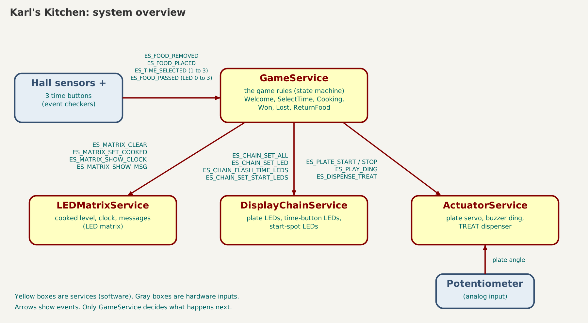

# Karl's Kitchen: Team 3 (ME 218a, Fall 2026)

Our CHEF is a microwave game, a bit like whack-a-mole. The player picks up the food, chooses a cook time, then
turns a knob to spin the plate toward whichever LED lights up. Reach it before it turns off and the food cooks a
little more. Fill the cooking meter before time runs out and the microwave dings and drops a TREAT.

Built on a PIC32MX170F256B and the ME218 Events & Services Framework.

Team: Christopher Luey, Jeremy Merritt, Alison Peckham, Adam Sabet

## How to play

1. The food sits on its start spot. Lifting it off wakes the game up.
2. The LEDs by the three time buttons flash. Press one: 30, 45 or 60 seconds. That button also sets the difficulty (1, 2 or 3).
3. One of the 4 LEDs around the plate lights at random.
4. Turn the potentiometer to spin the plate (centre = stopped, further = faster, either direction) until the food reaches that LED, before the LED turns off.
5. When the food gets there, the LED goes off and the cooked-level display on the LED matrix fills up a bit. Then another random LED lights.
6. Fill the matrix before the game clock runs out and you win: the microwave dings and a TREAT is dispensed. Run out of time and you lose.
7. When the game ends, the 5 LEDs around the food's start spot light up. Put the food back to reset. The buttons do nothing until it's back.
8. If nobody touches anything for 20 seconds, the game resets.

What happens when the player misses an LED (it turns off before they reach it) isn't decided yet. Right now a new LED just lights.

## Meeting the project spec

| Requirement | How we do it |
|---|---|
| 3 or more inputs | Hall sensors (food position), potentiometer, time buttons |
| Analog input | The potentiometer angle sets the plate's speed and direction (proportional, not a threshold) |
| Non-contact sensing | Hall sensors |
| 3 or more kinds of feedback | LEDs and LED matrix, buzzer ding, plate motor, TREAT |
| Moving parts | DC gearmotor plate and a DC gearmotor TREAT dispenser |
| Time display | Game clock shown on the LED matrix |
| 20 second timeout | Inactivity timer resets the game |

## How the system is organized

Four services, each owned by one teammate. `GameService` makes all the decisions and tells the others what to show or move.



### Game states

| State | What's happening | Moves on when |
|---|---|---|
| Welcome | Idle, waiting for someone to start | Food lifted off (`ES_FOOD_REMOVED`) |
| SelectTime | Time-button LEDs flash | A button is pressed (`ES_TIME_SELECTED`), or 20 s with no input |
| Cooking | Random LEDs, plate spinning, clock running | Matrix full (`ES_COOKED`) or clock out (`ES_GAME_CLOCK_ELAPSED`) or 20 s with no input |
| Won | Ding, TREAT, result shown for 10 s | The result timer ends |
| Lost | Result shown for 10 s | The result timer ends |
| ReturnFood | The 4 start LEDs are lit. Everything else is ignored | Food put back (`ES_FOOD_PLACED`) |

After Won, Lost or a timeout, the game goes to ReturnFood if the food isn't on its start spot, or straight to Welcome if it is.
The original hand-drawn diagram is in `docs/Checkpoint_1.pdf`.

## What each teammate needs to know

Each owner works in their own service. Don't edit `ES_Configure.h` on your branch (see "Working with Git").

The 4 plate LEDs and the 4 Hall sensors next to them use the same numbers everywhere:
0 = North, 1 = East, 2 = South, 3 = West.

### LED matrix (`LEDMatrixService`)

You receive:

| Event | Parameter | What to do |
|---|---|---|
| `ES_MATRIX_CLEAR` | none | Blank the matrix |
| `ES_MATRIX_SET_COOKED` | cooked level, 0 to `MATRIX_MAX_COOKED_LEVEL` | Show how full the cooking meter is |
| `ES_MATRIX_SHOW_CLOCK` | seconds elapsed | Show the passing of game time (shown as time left) |
| `ES_MATRIX_SHOW_MSG` | a `DisplayMsg_t` from `LEDMatrixService.h` | Show a message on the timer display |

`GameService` shows `MSG_WELCOME` in Welcome, `MSG_SET_TIME` in SelectTime, `MSG_DONE` on a win, `MSG_TIME_UP` on a loss and
`MSG_TIMEOUT` after 20 s with no input. The message stays up during ReturnFood.

You can ask `GameService` for these (include `GameService.h`):
- `GetDifficulty()` returns 1, 2 or 3 (which time button was pressed), or 0 if no game has started.
- `GetGameSeconds()` returns the game length: 30, 45 or 60 (0 if no game).
- `MATRIX_MAX_COOKED_LEVEL` (in `ES_Configure.h`, currently 8) is how many hits fill the meter. It can be raised.

Your timer is `MATRIX_TIMER` (3). `ES_MATRIX_STEP_DONE` is yours to use inside your own service.

### Plate LEDs (`DisplayChainService`)

You receive:

| Event | Parameter | What to do |
|---|---|---|
| `ES_CHAIN_SET_ALL` | brightness 0 to 255 | Set every plate LED |
| `ES_CHAIN_SET_LED` | `(LED number << 8) \| brightness` | Set one plate LED. Numbers 0 to 3 are the plate LEDs. Brightness 0 is off |
| `ES_CHAIN_FLASH_TIME_LEDS` | 1 start, 0 stop | Flash the 3 LEDs next to the time buttons |
| `ES_CHAIN_SET_START_LEDS` | 1 on, 0 off | Light the 5 LEDs around the food's start spot ("put the food back") |
| `ES_CHAIN_SET_BELL` | 1 on, 0 off | Buzzer on or off (from `ActuatorService`, which times the ding) |

Two chained 74HC595s, as on the schematic. First 595: QA bell, QB to QE plate LEDs North, East, South, West, QF to QH the
30s, 45s and 60s button LEDs. Second 595: QA to QE the 5 start-spot LEDs, QF and QG the plate motor's H-bridge IN3 and IN4
(these two outputs were unused on the schematic). Brightness is on or off (no dimming).
You also receive `ES_CHAIN_SET_BELL` and `ES_CHAIN_SET_MOTOR_DIR` from `ActuatorService`.
`GetDifficulty()` is available to you too. Your timer is `CHAIN_TIMER` (4).

### Actuators (`ActuatorService`)

You receive:

| Event | What to do |
|---|---|
| `ES_PLATE_START` | Start letting the potentiometer spin the plate |
| `ES_PLATE_STOP` | Stop the plate |
| `ES_PLAY_DING` | Sound the buzzer |
| `ES_DISPENSE_TREAT` | Run the TREAT dispenser |

Plate: the larger 37 mm gearmotor (the one with the encoder) on H-bridge channel B: ENB on RB15 (PWM from OC1), IN3 and IN4
on the second 595's QF and QG. 1 kHz PWM from Timer2. The encoder isn't connected: the pot sets speed, not position.

Dispenser: the smaller gearmotor (no encoder) on channel A, one direction: ENA on RB11 (PWM from OC2), IN1 wired to 3.3 V and
IN2 to ground. To use a hobby servo instead, put its signal wire on RB11 and set `DISPENSER_IS_SERVO` to 1 at the top of
`ActuatorService.c` (50 Hz from Timer3, rest and drop positions in the same place).

The "pot" is the potentiometer RV1, the knob the player turns. Its wiper (middle pin) goes to RB12.

During a game the pot sets the plate's speed and direction: centre (within +/-80 counts) is stopped, then 30 % duty rising
to 70 % at the end of the travel. Direction changes stop the motor first. `ES_DISPENSE_TREAT` runs the dispenser at 60 %
for 1 s. `ES_PLAY_DING` turns the buzzer on for 0.4 s through `DisplayChainService`. All these numbers are starting
values at the top of `ActuatorService.c`. Test keys: `a` plate follows pot, `j` / `k` forward / reverse at 50 %, `x` stop,
`d` dispense, `b` ding, `?` status.

Your timers are `PLATE_SAMPLE_TIMER` (5), `DISPENSER_TIMER` (6) and `DING_TIMER` (8).

### Analog inputs (`AnalogInputs.c`)

`Check4PlateHalls` reads the 4 plate Hall sensors, the food start-spot Hall sensor and the pot one at a time with the ADC. It posts `ES_FOOD_PASSED` to `GameService` with the
sensor number (0 to 3) when the magnet under the food arrives. While the magnet stays there it repeats every 200 ms, so a
newly lit LED under the food still counts. `GameService` only counts it if that LED is the lit one. At power-up it measures
each sensor's resting value. If the magnet is sitting next to one sensor, that sensor's value is estimated from the other three.
The start-spot sensor reads 1 (above 700 counts) with the food on it and 0 (below 600) with the food off, and has to read the
same three times in a row before it changes. `IsFoodAtStart()` feeds `Check4FoodSensor` and `GetPotReading()` feeds
`ActuatorService`. Turning the pot posts `ES_USER_ACTIVITY`, so it counts as input for the 20 s timeout.
`InitAnalogInputs()` and `InitTimeButtons()` are called from `main()`.

### Game logic (`GameService`, hall sensor, buttons)

`EventCheckers.c` has `Check4FoodSensor` (posts `ES_FOOD_REMOVED` and `ES_FOOD_PLACED`, using the start-spot Hall sensor) and
`Check4TimeButtons` (RA2, RA3, RA4 to ground with internal pull-ups; debounces and posts `ES_TIME_SELECTED` with 1 to 3).

## Events

| Event | Sent by | Received by | Parameter |
|---|---|---|---|
| `ES_FOOD_REMOVED` | `Check4FoodSensor` | `GameService` | none |
| `ES_FOOD_PLACED` | `Check4FoodSensor` | `GameService` | none |
| `ES_TIME_SELECTED` | `Check4TimeButtons` | `GameService` | button number 1 to 3 (also the difficulty) |
| `ES_FOOD_PASSED` | `Check4PlateHalls` | `GameService` | LED number 0 to 3 |
| `ES_USER_ACTIVITY` | `Check4PlateHalls` (pot turned) | `GameService` | none |
| `ES_COOKED`, `ES_GAME_CLOCK_ELAPSED` | `GameService` | `GameService` | none |
| `ES_MATRIX_CLEAR`, `ES_MATRIX_SET_COOKED`, `ES_MATRIX_SHOW_CLOCK`, `ES_MATRIX_SHOW_MSG` | `GameService` | `LEDMatrixService` | see above |
| `ES_CHAIN_SET_ALL`, `ES_CHAIN_SET_LED`, `ES_CHAIN_FLASH_TIME_LEDS`, `ES_CHAIN_SET_START_LEDS` | `GameService` | `DisplayChainService` | see above |
| `ES_CHAIN_SET_BELL` | `ActuatorService` | `DisplayChainService` | 1 on, 0 off |
| `ES_CHAIN_SET_MOTOR_DIR` | `ActuatorService` | `DisplayChainService` | 0 stop, 1 forward, 2 reverse |
| `ES_PLATE_START`, `ES_PLATE_STOP`, `ES_PLAY_DING`, `ES_DISPENSE_TREAT` | `GameService` | `ActuatorService` | none |

Timers: 0 inactivity (20 s), 1 game clock, 2 result screen, 3 matrix, 4 plate LED chain, 5 plate sampling, 6 dispenser run time,
7 how long a plate LED stays lit, 8 ding length. Timers 9 to 15 are free.

## Testing the game logic without hardware

Keyboard testing on the board (terminal at 115200 baud) and in the simulator use the same keys:

| Key | Does |
|---|---|
| `f` | food lifted off |
| `p` | food put back |
| `1` `2` `3` | time buttons |
| `w` `e` `r` `t` | food reached plate LED 0, 1, 2, 3 |

To run the simulator on a normal Linux computer (needs `gcc`):

```bash
./tools/host_sim/run_sim.sh
```

It also has keys for timers: `c` is one second of clock, `l` is the LED timer, `i` is the inactivity timer, `x` is the result timer.

## Pins

From the KiCad schematic (`ME_218a_Project_Core_Functionality_Schematic`). The code uses exactly these. If the schematic
changes, change the code in the same pull request.

| Pin | Name | Net | Used in |
|---|---|---|---|
| 1 | MCLR | reset (10k pull-up, button SW1) | |
| 2 | RA0 / AN0 | Hall South | `AnalogInputs.c` |
| 3 | RA1 / AN1 | Hall West | `AnalogInputs.c` |
| 4 / 5 | RB0 / RB1 | PGED1 / PGEC1 (Snap) | |
| 6 | RB2 / AN4 | Hall North | `AnalogInputs.c` |
| 7 | RB3 / AN5 | Hall East | `AnalogInputs.c` |
| 9 | RA2 | 30s Button (to ground) | `EventCheckers.c` |
| 10 | RA3 | 45s Button (to ground) | `EventCheckers.c` |
| 11 | RB4 | CS1 (matrix SPI SS, through the 74HC244) | `LEDMatrixService.c` |
| 12 | RA4 | 60s Button (to ground) | `EventCheckers.c` |
| 14 | RB5 | SDO1 (matrix SPI data) | `LEDMatrixService.c` |
| 15 | RB6 | serial from the CP2102 (U1RX) | framework `terminal.c` |
| 16 | RB7 | serial to the CP2102 (U1TX) | framework `terminal.c` |
| 17 | RB8 | LED Data (595 SER) | `DisplayChainService.c` |
| 18 | RB9 | LED SRCLK | `DisplayChainService.c` |
| 21 | RB10 | LED RCLK | `DisplayChainService.c` |
| 22 | RB11 | Dispenser motor ENA (OC2 PWM). Schematic net: Dispenser Servo | `ActuatorService.c` |
| 23 | RB12 / AN12 | Pot Wiper | `AnalogInputs.c` |
| 24 | RB13 / AN11 | Hall Food Start | `AnalogInputs.c` |
| 25 | RB14 | SCK1 (matrix SPI clock) | `LEDMatrixService.c` |
| 26 | RB15 | Plate motor ENB (OC1 PWM). Schematic net: Plate Servo | `ActuatorService.c` |

On the 595 chain: Bell (buzzer), the 4 plate LEDs, the 3 time-button LEDs, the 5 start-spot LEDs and the plate motor's
IN3 / IN4 (see Plate LEDs above). Every I/O pin is used.

The schematic still shows servos. The H-bridge needs adding to it: ENA to RB11, ENB to RB15, IN3 / IN4 to the second
595's QF / QG, IN1 to 3.3 V, IN2 to ground, plus the motor supply.

## Working with Git

| Branch | Owner | Covers |
|---|---|---|
| `main` | everyone, by pull request | Always builds. Shared files |
| `game-logic` | Adam | `GameService`, `EventCheckers` |
| `actuators` | Christopher | `ActuatorService` |
| `led-matrix-display` | Alison | `LEDMatrixService`, SPI and matrix HAL files |
| `display-chain` | Jeremy | `DisplayChainService`, `AnalogInputs` |

- Work only on your own branch. Never push straight to `main`.
- Commit small and often, with a short message that says what changed.
- When something works, open a pull request into `main`. Someone else looks it over first.
- Before the pull request, run `git merge main` on your branch and make sure it still builds.
- `ES_Configure.h` already has every service, event and timer we need. If you need a new one, make a small pull request to `main` that adds just that line.

Repo layout: `FrameworkHeaders/` and `FrameworkSource/` (course framework), `ProjectHeaders/` and `ProjectSource/` (our code),
`tools/host_sim/` (simulator), `docs/` (spec, slides, checkpoint PDFs), `hardware/` (KiCad schematic and BOM).

## Build setup (XC32, MPLAB extension for VS Code)

Everyone builds on their own machine. The generated project files aren't in the repo because they contain paths specific to each computer.

1. Create a new MPLAB project (PIC32MX170F256B, Application, XC32) and delete its sample `main.c`.
2. Copy the four source folders from this repo into the project folder.
3. Add every `.c` file in `FrameworkSource` and `ProjectSource` to the project.
4. Add `FrameworkHeaders` and `ProjectHeaders` as include directories, in the project settings or with a `user.cmake` in
   `cmake/<project>/default/` and `cmake/<project>/default.production/`:
   ```cmake
   target_include_directories(<project>_default_default_XC32_compile PRIVATE
       "${CMAKE_CURRENT_SOURCE_DIR}/../../../FrameworkHeaders"
       "${CMAKE_CURRENT_SOURCE_DIR}/../../../ProjectHeaders")
   ```
5. The config bits are in the framework's `ES_Port.c`. Don't add a second set in your own files.
6. Build with Production.

## Schedule

| Date | What |
|---|---|
| 11/4 | Design review (done) |
| 11/8 | Checkpoint 1 submission. Team meeting 11/9 |
| 11/13 | Checkpoint 2: 3 inputs sensed, a state machine with 3 or more states run from the keyboard, one actuator working, updated schematic |
| 11/17 | Checkpoint 3: everything integrated, all actuators running |
| 11/18, 1 to 5 pm | Grading session (30 second pitch) |
| 11/18, 7 pm | Public presentation in the 550 Atrium |
| 11/30, 4 pm | Report draft (a hosted website) |
| 12/1, 11:30 am | Peer review of the partner team's report |
| 12/4, 5 pm | Final report |
